# Private Bounties on Midnight: Architecture

**Status:** draft v0.1, 2026-10-20. High-level design, written before the week-1 spike.
Anything marked 🔬 is unproven and gets tested in the spike before we build on it. Code blocks
are **pseudocode, not Compact**. Midnight-specific facts were checked against the Compact
standard library at `compactc-v0.31.1` and against
[midnight-examples](https://github.com/midnightntwrk/midnight-examples) at `cb250c9`.

---

## 1. Summary

Someone posts a **reward** and a **checker**. A solver proves, in zero knowledge, that their
answer passes the checker. In the **same transaction**, the contract:

- stores the answer **encrypted to the poster's key**;
- pays the reward to the solver as a **shielded coin**.

Only the poster can read the answer, and the poster can't avoid paying, because payment and
delivery are one atomic step. If nobody solves the bounty by the deadline, the poster takes the
reward back.

Researchers call this **zero-knowledge contingent payment (ZKCP)**. It has been studied since 2016,
but nobody runs it in production. Midnight can do what earlier designs couldn't: verify the
checker, the key exchange and the encryption **inside one proof**, and settle with shielded tokens.

We're building it in the open during Build Club. Once it's built and thoroughly tested, its
building blocks get split into standalone examples.

## 2. The problem we fix

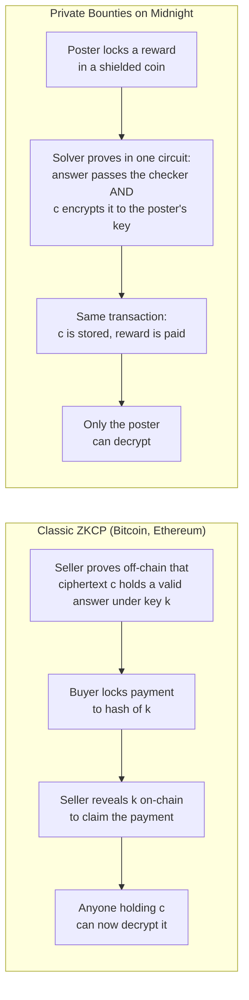

The key never goes on-chain. The solver encrypts **directly to the poster's public key** with a
Diffie-Hellman key exchange on the Jubjub curve, and the proof shows it was done correctly.

## 3. Goals and non-goals

**Goals**
- A working DApp (contract, API and UI) on a local network, then Preview and Preprod.
- It shows how Midnight's privacy features work **together**, not one at a time.
- Every building block is testable and splittable into its own example.
- Builders can follow along: tutorials and decisions are written as we go.

**Non-goals (v1)**
- Large files. Payloads are a few hundred bytes: answers, records and credentials.
- Arbitrary checkers. Every checker is a Compact circuit, so v1 ships three templates.
- Real-value payments. The demo pays with a test token the app mints itself.
- Dispute resolution or reputation.

## 4. Actors and system context

| Actor | Role |
|---|---|
| **Poster** (buyer) | Posts a bounty: checker template, parameters, reward and deadline. Reads the answer. |
| **Solver** (seller) | Finds an answer, proves it passes and gets paid. |
| **Observer** | Anyone reading the chain or the indexer. Sees the bounty, never the answer. |
| **Lace wallet** | Balances, signs and submits transactions via the DApp Connector, and pays DUST fees. |
| **Proof server** | Runs locally and generates the ZK proofs, so private inputs never leave the machine. |
| **Midnight node and indexer** | Run the network and serve live contract state to the UI. |

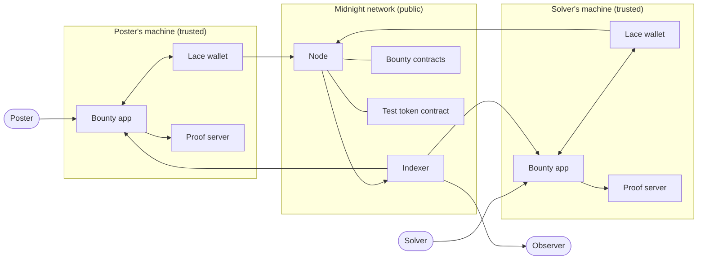

## 5. Two modes

| | **Open bounty** (v1, flagship) | **Private offer** (v2) |
|---|---|---|
| Who | One poster, any solver | One buyer, one seller who already has the data |
| Order | Reward first, then answers compete | Seller lists with proof, buyer pays, seller claims |
| Reward or price | **Public**: it's advertised to attract solvers | **Private**: committed, never in public state 🔬 |
| Key handling | Solver encrypts straight to the poster's key | Seller commits to key k at listing, then wraps k for the buyer at claim |
| Transactions for the solver | Stake + submit (or one, see Q3) | List + claim |
| Example use | "Factor N", "find the preimage", "a signed record with income ≥ X" | Sell a verified fact to one lender |

v1 builds the open bounty. The private offer reuses the same modules and adds a commitment to
k and a hidden price (section 14).

## 6. Component architecture

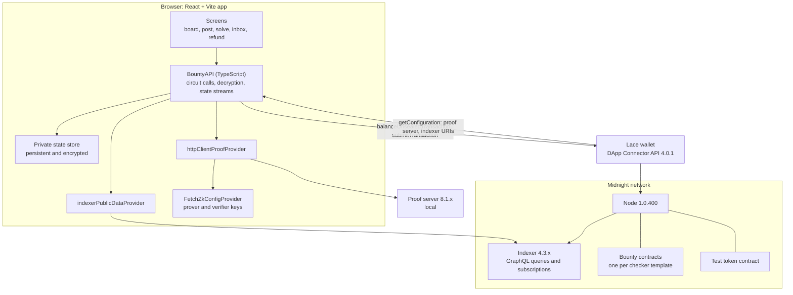

This follows the same wiring as the zk-loan example UI: `FetchZkConfigProvider`,
`httpClientProofProvider` and `indexerPublicDataProvider`, with the wallet's `getConfiguration()`
supplying the endpoints.
**One difference:** zk-loan keeps private state **in memory**. We can't, because the poster's
decryption key has to survive a reload, so we need a persistent, encrypted browser store (Q8).

### Repository layout (planned)

It mirrors a midnight-examples example, so pieces can move there later.

```
private-bounties/
├── contract/
│   ├── escrow.compact            module: shielded escrow, stake, payout
│   ├── deadline.compact          module: block-time windows
│   ├── ecdh.compact              module: Jubjub key exchange
│   ├── stream-cipher.compact     module: verifiable encryption
│   ├── pseudonym.compact         module: domain-separated keys
│   ├── bounty-preimage.compact   template contracts (import the modules)
│   ├── bounty-factor.compact
│   ├── bounty-signed-record.compact
│   ├── test-token.compact
│   ├── witnesses.ts
│   └── index.ts
├── src/          API layer, providers, simulator and integration tests
├── ui/           React app, started from midnight-examples templates/ui
├── spike/        week-1 measurements
├── docs/         this file, decisions, threat model
├── tutorials/    written as we build
└── compose.yml   local network: node, indexer, proof server
```

## 7. Contract design

### Module structure

Each checker template is its own contract, because a contract's circuits are fixed at deploy
time. One template contract hosts **many** bounties, each with its own public parameters. The
shared logic lives in modules imported with `import "<file>" prefix X_;`, which is how zk-loan
pulls in its Schnorr module.

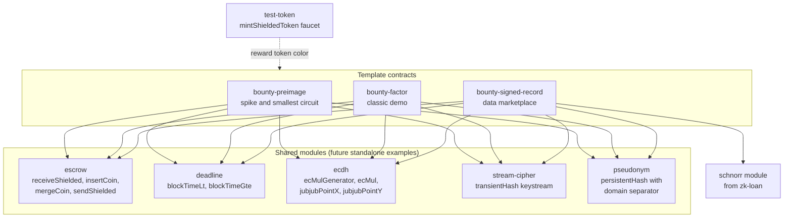

There are no cross-contract calls on this stack, and none are needed. The test token is an
ordinary shielded coin, and a template contract only checks its color.

### Ledger state (pseudocode)

```
bounties:   Map<BountyId, {
              poster:   Bytes<32>       // per-bounty pseudonym, not the wallet
              posterPk: JubjubPoint     // poster's encryption key, b·G
              params:   CheckerParams   // template-specific, public
              deadline: Uint<64>        // block time (units confirmed in spike, Q7)
              status:   OPEN | SOLVED | REFUNDED }>
escrows:    Map<BountyId, QualifiedShieldedCoinInfo>   // v1: public, written via insertCoin
stakes:     Map<StakeKey, Bytes<32>>                   // persistentCommit of a solver coin
deliveries: Map<BountyId, { E: JubjubPoint, c: Vector<N, Field> }>
tokenColor: sealed Bytes<32>                           // accepted reward token
```

### Circuits

| Circuit | Caller | What the proof shows | Public effects |
|---|---|---|---|
| `postBounty` | Poster | Poster pseudonym comes from their secret; the coin has the right color | Bounty record and escrow coin |
| `stake` | Solver | (none) | Stake commitment, coin held by the contract |
| `submit` | Solver | Checker passes, ECDH is correct, c encrypts the answer, stake opening is valid, before the deadline | `E`, `c`, status `SOLVED`, shielded payout |
| `withdrawStake` | Solver | Stake opening is valid | Stake returned (if the submit lost a race) |
| `refund` | Poster | Pseudonym matches; deadline passed; still `OPEN` | Status `REFUNDED`, escrow returned |
| `check` (pure) | Browser | No proof: runs in JS | None: pre-checks an answer before paying for a proof |
| `deriveKey`, `keystream` (pure) | Browser | No proof: runs in JS | None: decryption uses the exact circuit math |

Exporting pure circuits for off-chain use is the zk-loan pattern: `schnorrChallenge` lets
TypeScript compute exactly what the circuit computes.

## 8. Cryptography

### Key exchange and verifiable encryption (inside `submit`)

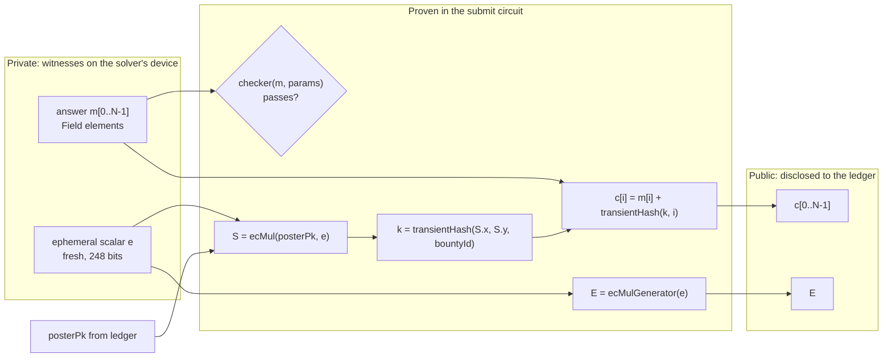

The poster decrypts off-chain: `S = b·E` (same point, because `b·(e·G) = e·(b·G)`), then
`k = transientHash(S, bountyId)`, then `m[i] = c[i] − transientHash(k, i)`.

Notes for implementation:
- **Scalars must be below the Jubjub order.** `e` comes from a 248-bit witness, so it is always in
  range. zk-loan's Schnorr module has the same constraint and reduces hash outputs to 248 bits.
- **`JubjubPoint` is opaque.** Compare points coordinate-wise with `jubjubPointX`/`jubjubPointY`,
  because `==` compiles to JS reference equality (a note in zk-loan's `schnorr.compact`).
- **Field addition, not XOR.** It is native and cheap in-circuit. Each `m[i]` must fit in a Field,
  so we pack about 31 bytes per element.
- **A keystream must never repeat.** Fresh `e` per submission and `bountyId` plus the index in
  the hash input give domain separation.
- **Pin the hash.** Decryption has to use the same `transientHash` as the circuit that made the
  ciphertext. The UI calls the pure circuits **from the same compiled contract**, so a compiler
  upgrade can't silently break old ciphertexts. 🔬 Q4

### Private offer (v2): wrapping a committed key

In v2 the seller encrypts under their own key `k` at listing time, before any buyer exists, and
commits to `k`. At claim time they prove `kWrapped = k + transientHash(ECDH(e, buyerPk))` for the
committed `k`. Same building blocks, one extra commitment.

## 9. Escrow and payout privacy

This is the subtlest part of the design, and it builds directly on what shielded-chips already does.

**What the stdlib does (0.31.1):** `sendShielded` and `mergeCoin` derive the new coin's nonce
deterministically from the **first** input coin's nonce. A coin commitment is a hash of
`(nonce, color, value, recipient)`. So if a coin's nonce is public, anyone can compute the payout
coin's nonce and **test a guessed wallet key** against the commitment.

**What shielded-chips does:** a player's escrowed coin is stored only as a
`persistentCommit([nonce, color, value], salt)` and replayed from private state through a witness
at claim time. Its own comment notes the cost: *only the player can reopen the escrow commitment.*

**Our problem:** in an open bounty the **solver** claims a coin the **poster** escrowed. The
solver can't reopen the poster's commitment. So in v1 the escrow coin is stored publicly
(`insertCoin`, as with shielded-chips' `houseCoins`), which is fine because the reward is
advertised anyway. That makes the escrow nonce public, though, so a direct payout would be
linkable.

**The fix (reusing shielded-chips' `claimWinnings` trick):** the solver adds a coin of their own
with a secret nonce, and the contract merges **the solver's coin first**.

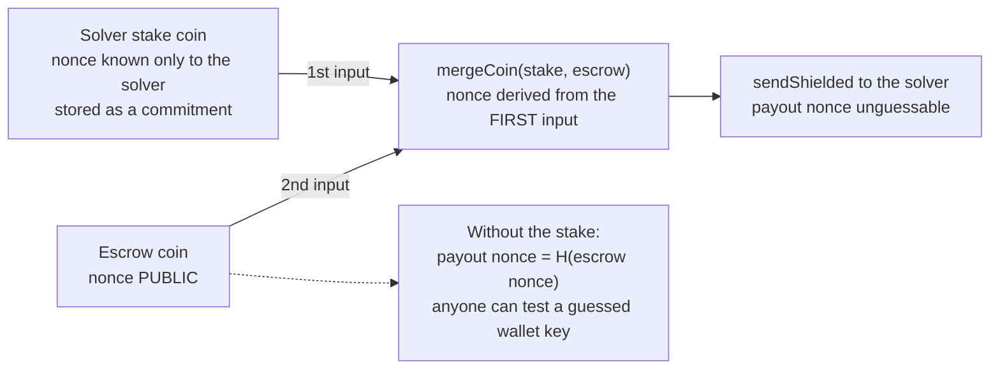

The stake also works as anti-spam, and it comes back with the payout. If the bounty is
already solved, `withdrawStake` returns it.

🔬 **Q3:** `mergeCoinImmediate(a, b)` exists but puts the **stored** coin first. If a coin received
in the same transaction can be the first input, the solver needs one transaction instead of two.
If not, the stake is a separate earlier transaction.

**Refunds:** the poster's refund comes from the public escrow coin, so it is linkable to the
poster's wallet **by someone who already suspects that wallet**. v1 documents this, and the same
merge trick can fix it later if it matters.

**v2 private offers:** the buyer escrows with a commitment only (the shielded-chips pattern, minus
the public value) and gives the opening to the one seller. The price never enters public
state. 🔬 Q2

## 10. Bounty lifecycle

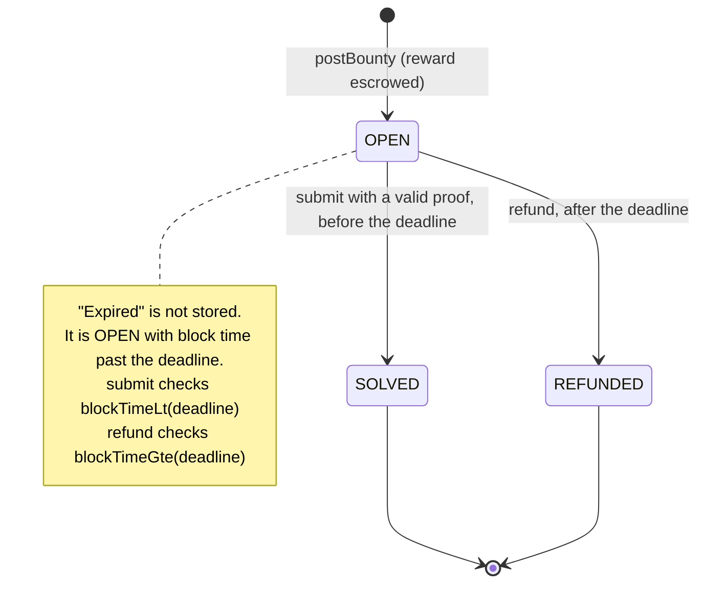

## 11. User flows

### Poster


### Solver

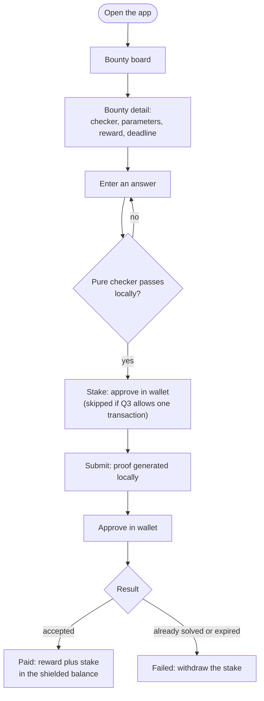

### Screens

| Screen | Data source | Midnight piece |
|---|---|---|
| Bounty board | Indexer subscription on the template contracts | `indexerPublicDataProvider`, contract state stream |
| Post a bounty | Form, then a `postBounty` transaction | DApp Connector, proof server |
| "What goes public" review | Static, per template | Selective disclosure, made visible |
| Bounty detail | Ledger state | Public params, deadline countdown from block time |
| Solve | Pure checker, then `stake` and `submit` | Local proving, witnesses, shielded coins |
| My bounties / inbox | Ledger state and private state | Private state store, pure-circuit decryption |
| Refund | `refund` transaction | Block time |

## 12. Transaction sequences

### Post a bounty

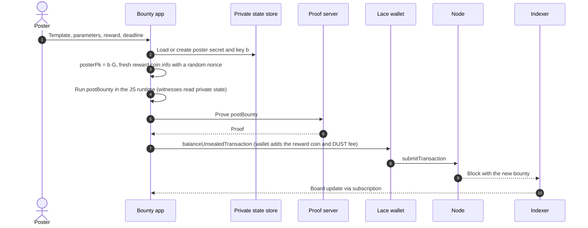

### Solve and get paid

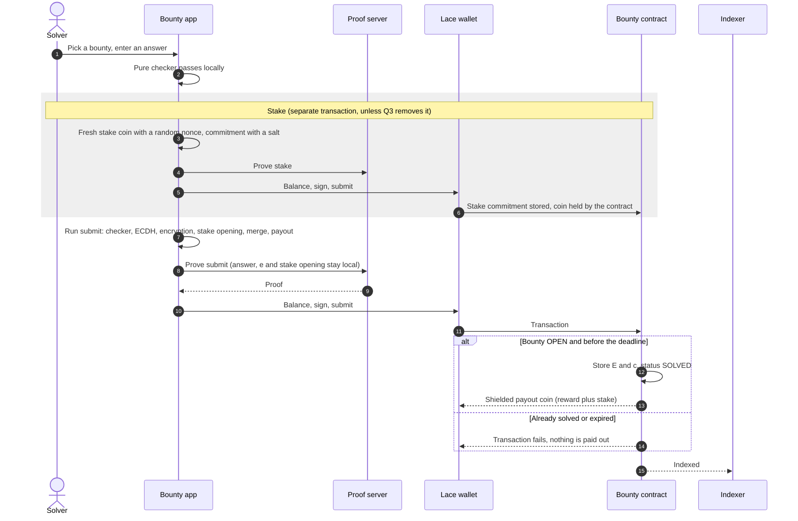

### Read the answer

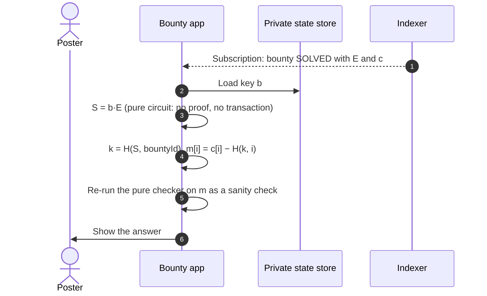

### Refund after the deadline

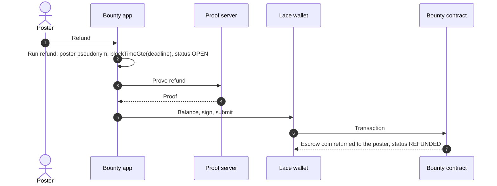

### Private offer (v2)

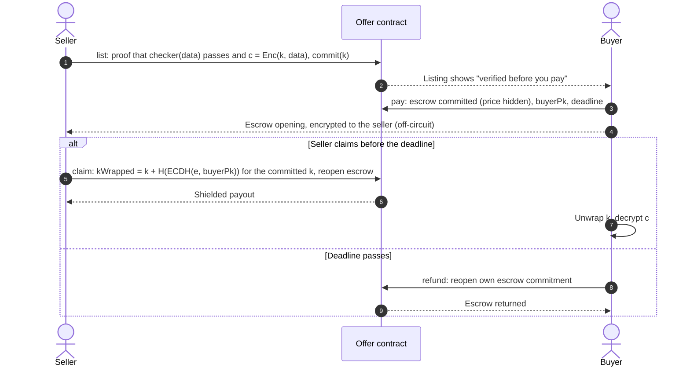

If the buyer sends a wrong opening, the seller can't claim, so they never reveal `kWrapped`, and
the buyer simply gets a refund. Neither side can cheat the other.

## 13. Midnight features: where each one does its job

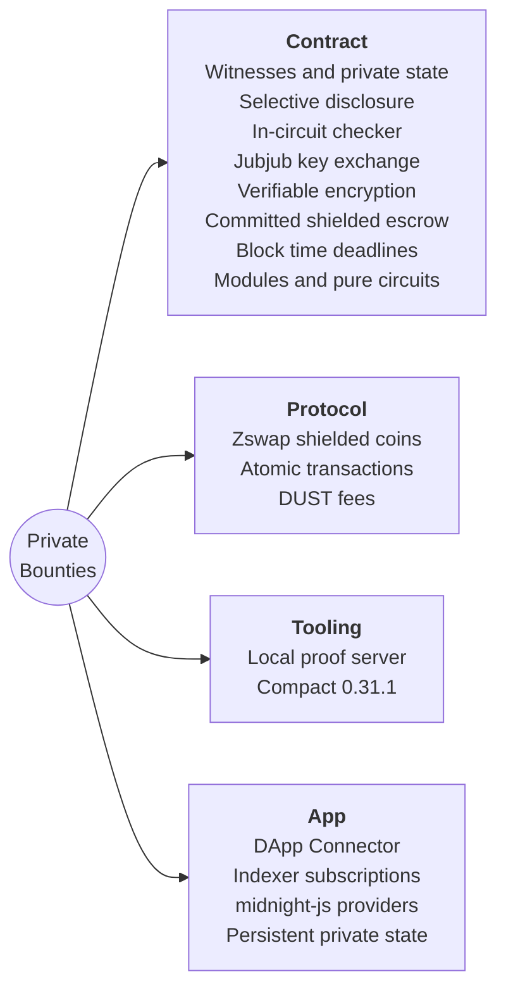

| Feature | Its job here | In midnight-examples today (`cb250c9`) |
|---|---|---|
| Witnesses and private state | Answer, `e`, stake opening and key `b` never leave the device | Every example |
| Selective disclosure (`disclose`) | Only `E`, `c`, status and commitments go public | Every example |
| Commitments and hashing (`persistentCommit`, `persistentHash`, `transientHash`) | Stake commitment, pseudonyms, keystream | Many |
| ZK check of off-chain data | The checker runs inside the proof, before payout | zk-loan, calculator |
| Jubjub ops in-circuit (`ecMulGenerator`, `ecMul`) | Key exchange to the poster | **New use.** Only zk-loan, to verify Schnorr signatures |
| Verifiable encryption | Proves `c` encrypts the checked answer | **New** |
| Shielded escrow (`receiveShielded`, `insertCoin`, `mergeCoin`, `sendShielded`) | Reward escrow, stake and unlinkable payout | shielded-chips (committed player escrow), private-tip-jar, token-transfers. **New here:** a third party claims, and in v2 the price is hidden |
| Block time (`blockTimeLt`, `blockTimeGte`) | Submit window and refund | **New.** No example uses it |
| Modules (`import ... prefix`) | Shared building blocks | zk-loan only |
| Pure circuits in JS | Browser pre-check and decryption with the exact circuit math | zk-loan (`schnorrChallenge`) |
| Shielded token minting (`mintShieldedToken`) | Test reward token | private-tip-jar, shielded-chips, token-transfers |
| Domain-separated pseudonyms | Unlinkable posters and solvers | shielded-chips and others |
| Atomic transactions | Delivery and payout land together or not at all | Implicit everywhere, central here |
| Local proof server | Private inputs proven on the user's machine | Every example |
| DApp Connector | Balancing, signing, submitting, endpoints | Example UIs |
| Indexer subscriptions | Live bounty board | Example UIs |

### What happens inside one `submit`

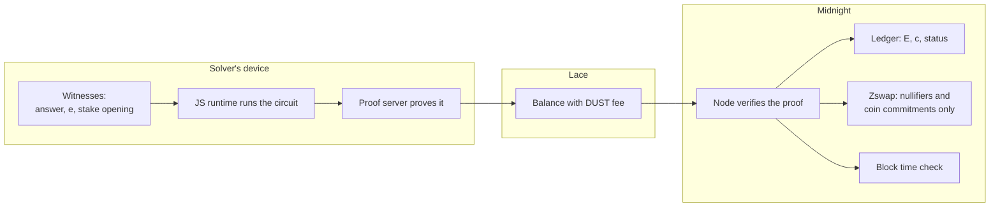

## 14. Privacy model

| Data | Who can see it |
|---|---|
| The answer | Solver; poster after decryption. On-chain only as ciphertext |
| Checker parameters, deadline | Public |
| Reward amount (open bounty) | Public, by design |
| Price (private offer, v2) | Buyer and seller only 🔬 Q2 |
| Poster identity | Per-bounty pseudonym. The wallet isn't linked |
| Solver identity | Per-bounty pseudonym |
| Payout destination | Shielded coin, unlinkable thanks to the stake merge (section 9) 🔬 Q2 |
| Refund destination | Linkable only by someone who already suspects the poster's wallet (v1 limit) |
| Poster key `b`, solver scalar `e` | Private state, and `e` is discarded after proving |
| Fees | Paid in DUST |
| Metadata | Timing and transaction graph. Not hidden by the app |

## 15. Threat model

| Threat | Mitigation |
|---|---|
| Solver submits a wrong answer | The checker runs in the circuit, so no valid proof means no payout |
| Solver encrypts garbage or uses the wrong key | The proof binds `c` to `posterPk` through ECDH and the keystream |
| Poster refuses to pay | Can't: payout and delivery are one transaction |
| Poster refunds early | `refund` requires `blockTimeGte(deadline)` |
| Solver submits late | `submit` requires `blockTimeLt(deadline)` |
| Two solvers race | The first to land wins. The other fails at the status check and withdraws the stake |
| Copying a pending submission | Nothing to copy: the answer is encrypted and the payout is bound in the proof |
| Payout traced to the solver's wallet | Solver's secret coin merged first (section 9) |
| Small answer space | The checker itself can leak the answer (a 4-digit PIN can be brute-forced). The UI warns, and templates avoid it |
| Field wraparound in a checker | Checkers use bounded `Uint` arithmetic (`p × q = N` with no modular wrap) |
| Invalid or low-order `posterPk` | Only hurts the poster. The UI generates and validates keys |
| Poster loses key `b` | An encrypted backup or export of the private state |
| Hash function changes between compiler versions | Decrypt with the pure circuits from the same compiled contract |
| A buyer re-shares purchased data (v2) | Inherent to selling data. Out of scope |

## 16. Checker templates (v1)

| Template | The bounty asks for | Public parameters | Private answer | Why it's in v1 |
|---|---|---|---|---|
| `preimage` | x with `persistentHash(x) = target` | target | x | Smallest circuit, used by the spike |
| `factor` | p, q > 1 with `p × q = N` | N | p, q | The classic ZKCP demo |
| `signed-record` | An issuer-signed record whose field f ≥ X | issuer key, f, X | Record and signature | Real data-marketplace use. Reuses zk-loan's Schnorr module |

## 17. Target stack

| Component | Version |
|---|---|
| Compact compiler | 0.31.1 (`compact compile +0.31.1 ...`) |
| `@midnight-ntwrk/compact-runtime` | The version 0.31.1 output expects (confirm in the spike) |
| midnight-js | 4.1.1 |
| DApp Connector API | 4.0.1 |
| `ledger-v8` | 8.1.x |
| `wallet-sdk-facade` | 4.1.0, pinned (the npm `latest` tag still points to 4.0.1) |
| Node / indexer / proof server | 1.0.400 / indexer-standalone 4.3.3 / 8.1.0 |
| Networks | Local, then Preview, then Preprod |

## 18. Open questions (answered by the spike)

| # | Question | How we test it |
|---|---|---|
| Q1 | Is `submit` provable in reasonable time and size? | Compile the preimage template with N = 4. Record circuit size (k), prover key size and proving time on the proof server |
| Q2 | What exactly is public after `postBounty`, `stake`, `submit`, `refund`? | Run on a local network. Inspect the transactions and the indexer data: value, recipient, nonces |
| Q3 | Can a coin received in the same transaction be the **first** merge input? | Try it. If yes, drop the separate stake transaction |
| Q4 | Do pure circuits in the browser reproduce the circuit's `ecMul` and `transientHash`? | Round trip: encrypt in `submit`, decrypt with the pure circuits |
| Q5 | Does a failing `submit` leave no partial state? | Force failures (expired, already solved, bad stake) and check the ledger |
| Q6 | Can Lace balance a transaction that pays in and receives a payout? | Run `stake` and `submit` through the DApp Connector |
| Q7 | Block time units and drift | Read the kernel's time in a test circuit and compare it with wall-clock time |
| Q8 | Persistent, encrypted browser private state | Prototype a store that survives a reload |
| Q9 | `JubjubPoint` and vectors inside ledger map values | Compile and run the ledger state from section 7 |

## 19. Build plan (tentative)

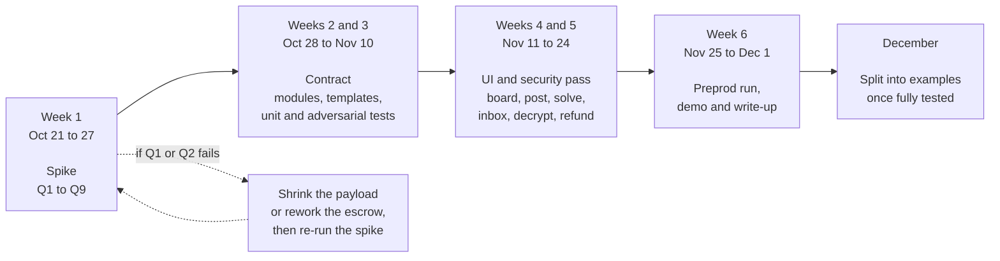

| Phase | Dates | Exit criteria |
|---|---|---|
| Spike | Oct 21 to 27 | Q1 to Q9 answered with numbers, or a design change agreed |
| Contract | Oct 28 to Nov 10 | Three templates, simulator tests plus adversarial cases passing |
| UI and security | Nov 11 to 24 | Full flow working on the local network, security pass done |
| Preprod and demo | Nov 25 to Dec 1 | End-to-end run on Preprod, demo recorded, write-up drafted |
| Examples | December | Modules split out with their own tests and docs |

## 20. Splitting into examples

Only after the full app is built and thoroughly tested:

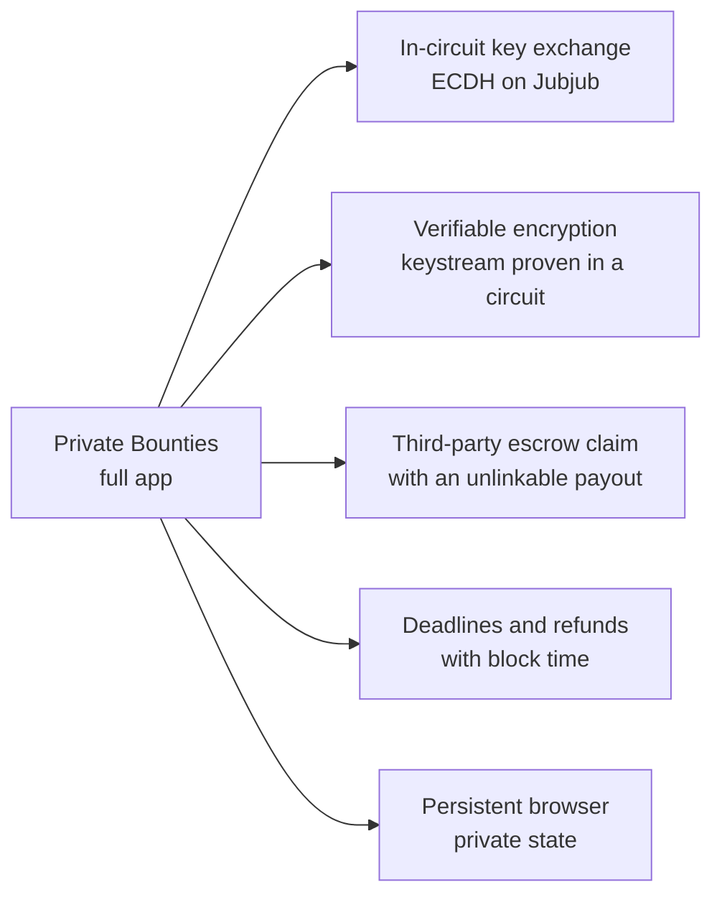

## 21. References

- Atomic and Fair Data Exchange via Blockchain, ACM CCS 2024: https://dl.acm.org/doi/10.1145/3658644.3690248
- cont-pay, a ZKCP prototype (CCS 2020): https://github.com/security-kouza/cont-pay
- Algebraic Zero-Knowledge Contingent Payment: https://eprint.iacr.org/2024/1930.pdf
- SmartZKCP, practical attacks on ZKCP marketplaces: https://www.sciencedirect.com/science/article/pii/S209672092400085X
- Compact standard library at `compactc-v0.31.1`: https://github.com/LFDT-Minokawa/compact/blob/compactc-v0.31.1/compiler/standard-library.compact
- midnight-examples `shielded-chips/contract/roulette.compact`: committed escrow and payout-nonce privacy
- midnight-examples `zk-loan/contract/schnorr.compact`: Jubjub ops, scalar reduction, modules, pure circuits
- Midnight docs: https://docs.midnight.network
