# Private Bounties on Midnight: Architecture

**Status:** draft v0.9, 2026-11-01. Updated with the spike results (Q1 to Q12 are answered or
decided; Q6 still needs a Lace run), the fixes from the first security audit
([report](docs/security-audit.md)) and the second ([report](docs/security-audit-2.md)), a title and question for every bounty (section 7), and a
second mode, **reviewed work**, for bounties a person has to judge (section 5; spike Q13 passed in
memory). Anything still marked 🔬 is unproven. Code blocks
are **pseudocode, not Compact**. Midnight-specific facts were checked against the Compact
standard library at `compactc-v0.31.1` and against
[midnight-examples](https://github.com/midnightntwrk/midnight-examples) at `cb250c9`.

---

## 1. Summary

Someone posts a **reward** and a **checker**. A solver proves, in zero knowledge, that their
answer passes the checker. In the **same transaction**, the contract:

- stores the answer **encrypted to the poster's key**;
- pays the reward to the solver as a **shielded coin**.

Only the poster can read the answer, and the poster can't avoid paying, because payment and
delivery are one atomic step. If nobody solves the bounty by the deadline, the poster takes the
reward back.

Researchers call this **zero-knowledge contingent payment (ZKCP)**. It has been studied since 2016,
but nobody runs it in production. Midnight can do what earlier designs couldn't: verify the
checker, the key exchange and the encryption **inside one proof**, and settle with shielded tokens.

Most real bounties are for work a person has to judge: build a tool, write a guide, host a
workshop. No circuit can check those, so a second mode, **reviewed work**, keeps what Midnight
adds (the reward locked up front, a private delivery, an unlinkable payout) and replaces the
proof of correctness with the poster's approval, a review clock and an optional arbiter
(section 5).

We're building it in the open during Build Club. Once it's built and thoroughly tested, its
building blocks get split into standalone examples.

## 2. The problem we fix


The key never goes on-chain. The solver encrypts **directly to the poster's public key** with a
Diffie-Hellman key exchange on the Jubjub curve, and the proof shows it was done correctly.

## 3. Goals and non-goals

**Goals**
- A working DApp (contract, API and UI) on a local network, then Preview and Preprod.
- It shows how Midnight's privacy features work **together**, not one at a time.
- Every building block is testable and splittable into its own example.
- Builders can follow along: tutorials and decisions are written as we go.

**Non-goals (v1)**
- Large files. Payloads are a few hundred bytes: answers, records and credentials.
- Arbitrary checkers. Every checker is a Compact circuit, so v1 ships three templates.
- Real-value payments. The demo pays with a test token the app mints itself.
- Dispute resolution beyond reviewed work's optional arbiter, who can only overturn a
  rejection. Reputation.

## 4. Actors and system context

| Actor | Role |
|---|---|
| **Poster** (buyer) | Posts a bounty: checker template, parameters, reward and deadline. Reads the answer. |
| **Solver** (seller) | Finds an answer, proves it passes and gets paid. |
| **Observer** | Anyone reading the chain or the indexer. Sees the bounty, never the answer. |
| **Wallet** | Lace, 1AM or any wallet that implements the DApp Connector. Balances, signs and submits transactions, and pays DUST fees. |
| **Proof server** | Runs locally and generates the ZK proofs, so private inputs never leave the machine. |
| **Midnight node and indexer** | Run the network and serve live contract state to the UI. |


## 5. Modes

| | **Open bounty** (v1, flagship) | **Reviewed work** (contract built, Q13) | **Private offer** (v2) |
|---|---|---|---|
| Who | One poster, any solver | One poster, one contributor at a time, an optional arbiter | One buyer, one seller who already has the data |
| Who decides it's done | The checker, inside the proof | The poster, or the arbiter on appeal | The checker, inside the proof |
| Order | Reward first, then answers compete | Reward first, then claim, deliver, review, collect | Seller lists with proof, buyer pays, seller claims |
| Reward or price | **Public**: it's advertised to attract solvers | **Public**, as in the open bounty | **Private**: committed, never in public state 🔬 |
| Key handling | Solver encrypts straight to the poster's key | Contributor encrypts the submission to the poster's key; no checker | Seller commits to key k at listing, then wraps k for the buyer at claim |
| Transactions for the solver or contributor | One: `submit` brings the solver's own coin in the same transaction (Q3, verified) | Three: claim (or apply), submit, collect | List + claim |
| Example use | "Factor N", "find the preimage", "a signed record with income ≥ X" | "Build a tool", "write a guide", "host a workshop" | Sell a verified fact to one lender |

v1 builds the open bounty. Reviewed work comes next: spike Q13 ran its contract in memory, and the template `bounty_reviewed_work` is built and passes its simulator and devnet tests. The private offer
reuses the same modules and adds a commitment to k and a hidden price (section 14).

### Reviewed work (spike Q13)

Nothing about the work is checked in a circuit; the poster approves it. What the contract adds
is that every promise is enforced: the reward is locked before anyone starts, the contributor
has an exclusive window to deliver, the poster has a fixed window to review, and silence pays
the contributor. Spike Q13 built the contract and ran it in memory
([results](spike/q13-reviewed-work/RESULTS.md)). What's still marked 🔬 needs a devnet run or a
decision.

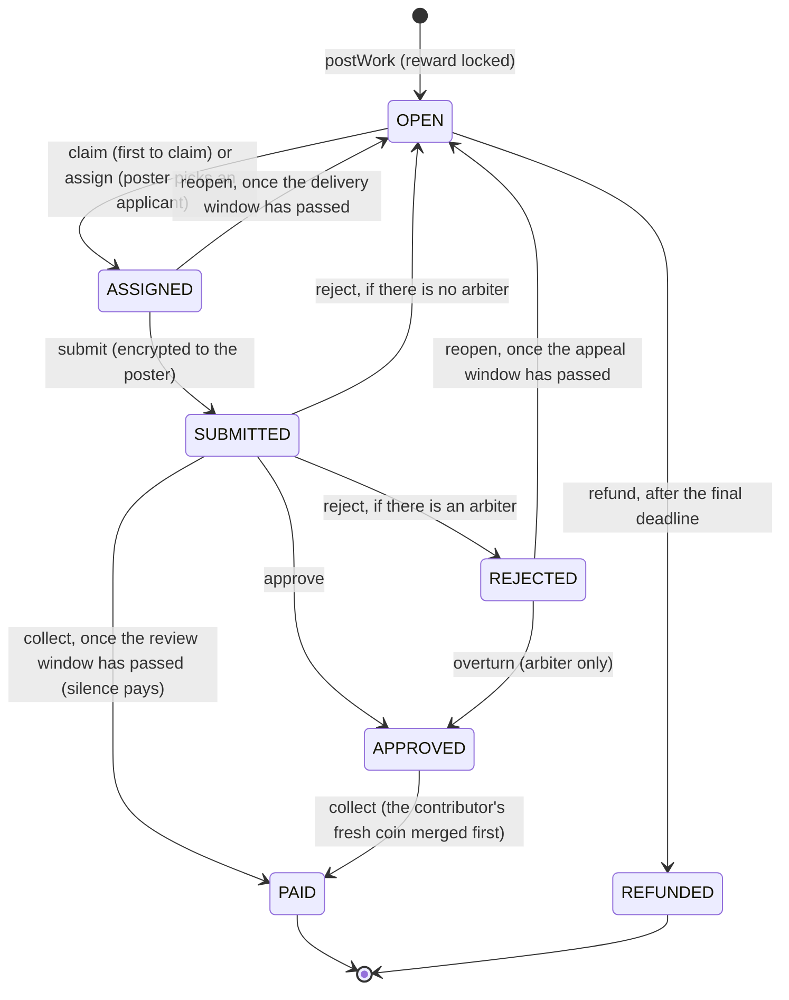

`refund` also takes back an assignment that ran out, or a rejection past its appeal window.
Submitted or approved work is never refundable.

| Piece | Proposal |
|---|---|
| Contributor identity | A per-bounty pseudonym from the contributor's own secret, as for posters. Nothing on chain links a contributor's bounties |
| Contributor profile | Off chain: a name and linked accounts. Each application chooses who sees it: the poster only (default, encrypted in the application), everyone once assigned, or nobody. GitHub is verified by a signed statement in a public gist, checked in the browser; other accounts show as unverified |
| Poster identity | Anonymous by default, or a verified organization name, so contributors know who is paying. How the name is verified is open 🔬 |
| Applications | **Decided (2026-11-03): application codes, off chain.** In applicant mode, the app turns an applicant's per-bounty pseudonym, a short plan and an optional profile into a code encrypted to the poster's key for that bounty. The applicant sends it however they like (Discord, GitHub, email), and the poster pastes it into the app to read it and `assign`. The key is the template's pure `applicationKey`: the same key exchange as a submission, bound to the bounty and to "application", so it never equals a submission's key. The app derives an AES-GCM key from it. No contract circuit, no fees, no server; the cost is that applications aren't listed on the board. **Updated the same day (Q15):** the app now also sends the code to the bounty's inbox on the Nostr relays, so it appears on the poster's page without copying; pasting a code still works when relays are down. The applicant's key in the code is their per-bounty contact key (from their identity secret), so the code also opens the chat |
| Windows | Compact has no clock value, only comparisons with block time. Whoever sets a window end passes it as an argument, and the circuit checks it lies between `now + window − slack` and `now + window`: `blockTimeGte(end − window)` and `blockTimeLt(end − window + slack)`. The check has to be two-sided, because the poster sets deliver-by and appeal-by and the contributor sets review-by, and each could cut the other's window short. `slack` is fixed per deployment and must cover the time a call takes to land: up to 2.5 minutes in Q6. **On a devnet (2026-11-02)** the template's tests ran with 15 minutes and window ends a minute short of `now + window`, and every window check held against real block timestamps; calls took 24 to 67 s to land |
| Claims | `claim` (first to claim) and `assign` (the poster picks an applicant's pseudonym) set deliver-by. Claims close once a full delivery window no longer fits before the final deadline, which the post form should show. `reopen` is its own circuit: anyone can call it on an assignment or a rejection whose window has passed |
| Review clock | `submit` sets review-by. The poster can approve or reject until then. After it, `collect` works without an approval |
| Submission | A link, encrypted to the poster with the existing key exchange and keystream. The four field elements hold about 124 bytes, enough for a link; notes go in messages |
| Payout | `approve` only changes the status. The contributor's `collect` receives a fresh coin of their own (it may be worth zero) and merges it first, as `submit` does (Q3), and pays reward plus coin to the caller. **Passed the Q2 leak checks on a devnet (2026-11-02):** the keys, the submitted link, the contributor's coin nonce, the payout nonce and both wallets' coin keys are not in public state, and the payout's nonce isn't the escrow coin's |
| Arbiter | Optional, named at post time, with the same id on every bounty because it's a known party. Its only power is to overturn a rejection within the appeal window. Without an arbiter, a rejection reopens the work at once |
| Locked rewards | Submitted work can't be refunded, so a contributor who submits and never collects leaves the reward locked for good. **Built:** each deployment sets a `collectWindow`. The contributor must collect before `until + collectWindow` (review-by, or appeal-by after an overturn), and after that the poster can `refund` submitted or approved work. Every window is capped at a year, so these times can't overflow |
| Squatting | In first-to-claim mode, one person can claim, let the window run out, and claim again, keeping a bounty blocked for one fee per window. **Decided (2026-11-01):** no claim deposit, so contributors never need tokens up front. Instead, applicant mode, where the poster picks, is the default, and first to claim is an option for small, well-defined tasks. In first-to-claim mode the poster can also `release` an assignment while nothing has been submitted, which reopens it. The trade-off is that a contributor released before submitting loses their effort, though no funds. `release` is built: poster only, first-to-claim only, and only while the work is assigned |
| Messages | **Decided (2026-11-03): public Nostr relays (Q15).** Encrypted between the poster's and the contributor's per-bounty keys, signed with a Nostr key derived from each side's per-bounty key, and tagged with a thread ID derived from their shared key. The app writes to four or five relays and merges what comes back. No contract change, no fees, no server; relays see the IP, timing and message count, never the parties, the bounty or the text. Chosen over on-chain messages (a transaction each) and Waku (its JS SDK looks unmaintained) |
| Reminders | Worked out in the browser from the windows in public state, with no bot or server |

## 6. Component architecture


This follows the same wiring as the zk-loan example UI: `FetchZkConfigProvider`,
`httpClientProofProvider` and `indexerPublicDataProvider`, with the wallet's `getConfiguration()`
supplying the endpoints.
**One difference:** zk-loan keeps private state **in memory**. We can't, because the poster's
decryption key has to survive a reload, so we need a persistent, encrypted browser store (Q8).
The UI template's store does that: midnight-js's LevelDB provider on IndexedDB, encrypted under a
passphrase, one store per wallet account.

### Repository layout

It mirrors a midnight-examples example, so pieces can move there later, and it runs inside a
midnight-examples checkout (as `examples/private-bounties`) for its simulator package, wallets and
devnet. Module file names use underscores because a module's name must be an identifier.

```
private-bounties/
├── contract/
│   ├── escrow.compact            module: receiveFresh, payMerged, payOut
│   ├── deadline.compact          module: assertOpen, assertExpired
│   ├── ecdh.compact              module: publicKey, sharedKey
│   ├── stream_cipher.compact     module: keystream, encrypt4, decrypt4
│   ├── pseudonym.compact         module: derive
│   ├── bounty_preimage.compact   template contract (built)
│   ├── bounty_factor.compact     template contract (built)
│   ├── bounty_signed_record.compact  template contract (built)
│   ├── bounty_reviewed_work.compact  template contract (built): reviewed work, section 5
│   ├── schnorr.compact           module from zk-loan: in-circuit Schnorr verification
│   ├── test_token.compact        test-only reward token
│   ├── witnesses.ts              one generic set of witnesses for every template
│   ├── signing.ts                off-chain Schnorr signing, for issuers of signed records
│   └── index.ts
├── src/          API layer, providers, simulator and integration tests
├── ui/           plain browser page, generated from midnight-examples templates/ui
├── app/          the product frontend (Midnight design), reusing ui/'s wallet, providers and api file
├── spike/        week-1 measurements
├── docs/         this file, decisions, threat model
├── tutorials/    written as we build
└── compose.yml   local network: node, indexer, proof server
```

## 7. Contract design

### Module structure

Each checker template is its own contract, because a contract's circuits are fixed at deploy
time. One template contract hosts **many** bounties, each with its own public parameters. The
shared logic lives in modules imported with `import "<file>" prefix X_;`, which is how zk-loan
pulls in its Schnorr module.


There are no cross-contract calls on this stack, and none are needed. The test token is an
ordinary shielded coin, and a template contract only checks its color.

### Ledger state (pseudocode)

```
bounties:   Map<BountyId, {
              poster:   Bytes<32>       // per-bounty pseudonym, not the wallet
              posterPk: JubjubPoint     // poster's encryption key, b·G
              params:   CheckerParams   // template-specific, public
              deadline: Uint<64>        // block time, seconds since the Unix epoch (Q7)
              status:   OPEN | SOLVED | REFUNDED }>
escrows:    Map<BountyId, QualifiedShieldedCoinInfo>   // v1: public, a fresh coin, via insertCoin
deliveries: Map<BountyId, { E: JubjubPoint, c: Vector<N, Field> }>
listings:   Map<BountyId, { title: Opaque<"string">, details: Opaque<"string">,
                            reward: Uint<128>, postedAt: Uint<64> }>
rewardColor: sealed Bytes<32>                          // accepted reward token, set at deploy
minReward:   sealed Uint<128>                          // smallest reward, set at deploy
minWindow:   sealed Uint<64>                           // shortest time a bounty stays open, set at deploy
// BountyId = persistentHash("bounty:id", salt, sk): derived in postBounty from a secret salt and
// the poster's identity secret, so nobody else can post under it
```

A bounty's title and question (`details`) live in `listings`, apart from `bounties`. `postBounty`
writes them once. `submit` and `refund` rewrite the bounty record to change its status, and
would carry the text along each time if it lived there. No circuit checks the text: a circuit
can't read an `Opaque` string's length. The ledger caps any one cell at 32,768 bytes, which
bounds a listing. The UI caps the title at 80 characters and the question at 1,000, because every
character is public and paid for in the transaction.

Listings are permanent, so each deployment sets a **minimum reward** and a **minimum open
window**. `postBounty` checks the reward is at least `minReward`, and the deadline at least
`minWindow` after the post time. A spam post then locks capital for the window, not only fees
(second audit, L1). The UI deploys with a minimum of 10 and 30 minutes.

The listing also keeps the **reward** and the **post time**, so the board can show what a solved
or refunded bounty paid, and when it was posted, from current state alone (Q14). The reward is
the escrowed coin's value; the escrow entry itself is deleted on payout. The post time is
passed by the poster and checked against block time with `Deadline_assertRecent`: it must lie
between 15 minutes before the block time and the block time, which leaves room for proving,
approval and landing (Q6 took up to 2.5 minutes). The UI passes its clock minus a minute, so a
block clock running slightly behind can't reject it, rounded down to 5 minutes, so a device whose
clock is off doesn't leave the same offset on every bounty it posts (second audit, L2).

In `bounty_preimage` the checker's parameter is `target: Field`; `bounty_factor` stores its N in
the same slot. `bounty_signed_record` replaces it with `issuerPk: JubjubPoint`, `field: Uint<8>`
and `threshold: Uint<64>`. In every template the payload is four field elements
(`Vector<4, Field>`, about 124 bytes).

### Circuits

| Circuit | Caller | What the proof shows | Public effects |
|---|---|---|---|
| `postBounty` | Poster | The bounty ID comes from a secret salt and the poster's identity secret; the poster pseudonym comes from that secret and the ID; the reward is at least `minReward` and the deadline at least `minWindow` after the post time; the coin has the reward color and a non-zero value; the deadline is still ahead; the poster's key (and in signed-record, the issuer's) is on the curve, in the prime-order subgroup and not the identity; the post time is within 15 minutes before the block time | Bounty record, escrow coin, and a listing: title, question, reward, post time |
| `submit` | Solver | Checker passes, ECDH is correct, c encrypts the answer, before the deadline. Receives the solver's fresh coin, which may be worth zero, and merges it first | `E`, `c`, status `SOLVED`, one shielded payout: reward plus the solver's coin |
| `refund` | Poster | Pseudonym matches; deadline passed; still `OPEN` | Status `REFUNDED`, escrow returned |
| `answerHash`, `checkAnswer` (pure) | Browser | No proof: runs in JS | None: builds a bounty's target, and pre-checks an answer before paying for a proof |
| `posterPublicKey`, `decrypt` (pure) | Browser | No proof: runs in JS | None: the poster's key and decryption, with the exact circuit math |

Three secrets stay separate, as shielded-chips' lessons advise:
- the poster's identity secret `sk` (pseudonym, in-circuit);
- the poster's encryption key `b`, off-chain only. A new one is derived for every bounty from a
  32-byte seed (`keys.ts`), so bounties can't be linked through `b·G`. The seed can live in the
  private state, so one backup covers every bounty;
- the solver's ephemeral scalar `e`, which a witness draws fresh for every submission and which
  is never stored.

Exporting pure circuits for off-chain use is the zk-loan pattern: `schnorrChallenge` lets
TypeScript compute exactly what the circuit computes.

The first draft had a separate `stake` circuit, plus `withdrawStake` for a solver who lost a race.
Q3 showed a coin received in the same transaction can be merged first, so `submit` does it all in
one go. The one-transaction payout passed the same privacy checks as the two-step one (Q3b), so
the two-step version is no longer needed.

### Measured cost

| Part | k | Proving or transaction time | Source |
|---|---|---|---|
| Checker + key exchange + encryption (4 or 8 elements) | 11 | 0.4 s to prove (idle runner); 1.9 to 2.7 s (loaded laptop) | [Q1](spike/q1-proof-size/RESULTS.md) |
| Same core with a SHA-256 checker | 14 | 2.6 s (idle runner); 5.6 s (loaded laptop) | [Q1](spike/q1-proof-size/RESULTS.md) |
| Escrow `submit` (merge + payout) | 16 | about 100 s to 134 s per transaction, end to end | [Q2](spike/q2-escrow/RESULTS.md) |
| `postBounty`, `refund` | 15 | about 40 s to 67 s per transaction, end to end | [Q2](spike/q2-escrow/RESULTS.md) |
| **Full `submit`**: checker + key exchange + encryption + escrow | **16** | **about 11 s to prove (idle runner)**; 43 s (loaded laptop) | [Q11](spike/q11-full-submit/RESULTS.md) |
| Reviewed work `collect` (merge and payout) | 16 | 59 to 67 s per transaction, end to end, on a devnet runner; the same size as the preimage `submit`. Prover key 19.5 MB | [Q13](spike/q13-reviewed-work/RESULTS.md); the template, compiled with keys on 0.31.1, 2026-11-02 |
| Reviewed work `postWork`, `refund` | 15 | `postWork` 36 to 43 s per transaction, end to end. Prover keys 11.0 and 10.0 MB: the template's listing, minimums and derived ID cost the same as in the other templates | Same |
| Reviewed work `submit`, `claim`, `assign`, `release`, `approve`, `reject`, `overturn` | 13 | 24 to 30 s per transaction, end to end; the pseudonym's SHA-256 sets the size. Prover keys 2.8 to 3.1 MB | Same, and the devnet test, 2026-11-02 |
| Reviewed work `reopen` | 9 | Not measured. Prover key 0.15 MB | Same |
| Title and question on `postBounty` | 15, unchanged | The prover key grew by 85 bytes (11,017,896 to 11,017,981). The text's length doesn't change the circuit; it only adds to the transaction | `bounty_preimage`, compiled with keys on 0.31.1, 2026-10-31 |
| Reward and post time in the listing | 15, unchanged | The prover key grew by another 291 bytes, to 11,018,272; `refund` and `submit` are unchanged | `bounty_preimage`, compiled with keys on 0.31.1, 2026-11-01 |
| Second-audit fixes: the ID derived in the circuit, the minimum reward and window | 15, unchanged | `postBounty`'s prover key grew by about 7 KB (11,018,272 to 11,025,538 in preimage), one more `persistentHash`. `submit` and `refund` are unchanged in all three templates | All three templates, compiled with keys on 0.31.1, 2026-11-01 |

**Coin handling, not cryptography, sets the cost.** Every coin operation hashes commitments and
nullifiers with SHA-256 inside the standard library. The full `submit` (checker, key exchange,
encryption and escrow) is k = 16, the same as the escrow alone, so the cryptography is almost free
on top of it (Q11). The UI shows proving progress; expect around 11 s on an ordinary 4-core
machine, longer on a busy laptop. "Idle runner" times come from the `Spike benchmarks` workflow on
a GitHub `ubuntu-latest` runner; the others were measured on a heavily loaded
Intel i5 laptop, and "end to end" includes proving, wallet balancing and landing on chain.

## 8. Cryptography

### Key exchange and verifiable encryption (inside `submit`)


The poster decrypts off-chain: `S = b·E` (same point, because `b·(e·G) = e·(b·G)`), then
`k = transientHash(S, bountyId)`, then `m[i] = c[i] − transientHash(k, i)`.

Notes for implementation:
- **Scalars must be below the Jubjub order.** `e` comes from a 248-bit witness, so it is always in
  range. zk-loan's Schnorr module has the same constraint and reduces hash outputs to 248 bits.
- **`JubjubPoint` is opaque.** Compare points coordinate-wise with `jubjubPointX`/`jubjubPointY`,
  because `==` compiles to JS reference equality (a note in zk-loan's `schnorr.compact`).
- **Field addition, not XOR.** It is native and cheap in-circuit. Each `m[i]` must fit in a Field,
  so we pack about 31 bytes per element.
- **A keystream must never repeat.** Fresh `e` per submission and the bounty ID plus the index in
  the hash input give domain separation. The ID enters as a field element, which keeps 248 of its
  256 bits; that is harmless because the key also depends on the fresh `e`.
- **Keep the plaintext, and pin the runtime.** Decryption runs `transientHash` from the installed
  `@midnight-ntwrk/compact-runtime` package, not from the compiled contract, and the ledger allows
  that hash to change at a hard fork. So the poster's app decrypts as soon as a bounty is solved
  and keeps the plaintext in private state, and the app pins its exact runtime version. (An
  earlier draft claimed the compiled contract pins the hash; the audit showed it doesn't.)

### Private offer (v2): wrapping a committed key

In v2 the seller encrypts under their own key `k` at listing time, before any buyer exists, and
commits to `k`. At claim time they prove `kWrapped = k + transientHash(ECDH(e, buyerPk))` for the
committed `k`. Same building blocks, one extra commitment.

## 9. Escrow and payout privacy

This is the subtlest part of the design, and it builds directly on what shielded-chips already does.

**What the stdlib does (0.31.1):** `sendShielded` and `mergeCoin` derive the new coin's nonce
deterministically from the **first** input coin's nonce. A coin commitment is a hash of
`(nonce, color, value, recipient)`. So if a coin's nonce is public, anyone can compute the payout
coin's nonce and **test a guessed wallet key** against the commitment.

**What shielded-chips does:** a player's escrowed coin is stored only as a
`persistentCommit([nonce, color, value], salt)` and replayed from private state through a witness
at claim time. Its own comment notes the cost: *only the player can reopen the escrow commitment.*

**Our problem:** in an open bounty the **solver** claims a coin the **poster** escrowed. The
solver can't reopen the poster's commitment. So in v1 the escrow coin is stored publicly
(`insertCoin`, as with shielded-chips' `houseCoins`), which is fine because the reward is
advertised anyway. That makes the escrow nonce public, though, so a direct payout would be
linkable.

**The escrow coin must be a fresh coin.** The coin passed to `receiveShielded` describes a new
coin the transaction creates for the contract; the wallet pays for it from its own coins and keeps
the change under new nonces. So the app always builds it with a random nonce, never a wallet coin's
nonce, and the public escrow nonce then points at nobody (shielded-chips `LESSONS.md` §11).

**The fix for the payout (reusing shielded-chips' `claimWinnings` trick):** the solver brings a
fresh coin of their own, with a nonce only they know, and the contract merges **the solver's coin
first**. The payout's nonce then derives from that secret nonce.


**Q3, verified on a local devnet:** the solver's coin can be received in the same transaction as
the merge (we build its `QualifiedShieldedCoinInfo` with `mt_index` 0 and pass it first, rather than
using `mergeCoinImmediate`, which puts the stored coin first). So `submit` is a single
transaction, and the solver gets the reward plus their coin back in one payout.

**Q2, verified on a local devnet** with the two-step version: the escrow coin is public as
designed, while the solver's coin nonce, the payout nonce, both wallets' coin keys and the solver's
secret never appear in public state, and the payout nonce differs from the escrow nonce
([results](spike/q2-escrow/RESULTS.md)). **Q3b, verified:** the same checks pass for the
one-transaction payout.

**Racing solvers (Q5, verified):** two solvers submitting at once both spend the same escrow coin.
The first transaction lands; the node rejects the second as a whole (`TransactionInvalid(Zswap)`),
so the losing solver's coin never leaves their wallet. The escrow coin works as the lock.

**Refunds:** the poster's refund comes from the public escrow coin, so it is linkable to the
poster's wallet **by someone who already suspects that wallet**. v1 documents this, and the same
merge trick can fix it later if it matters.

**v2 private offers:** the buyer escrows with a commitment only (the shielded-chips pattern, minus
the public value) and gives the opening to the one seller. The price never enters public
state. 🔬 Q2

## 10. Bounty lifecycle


## 11. User flows

### Poster

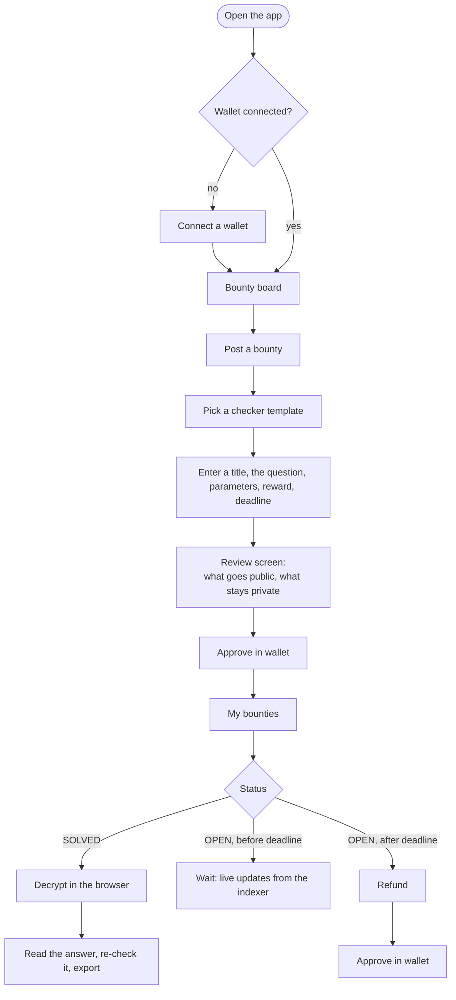

### Solver

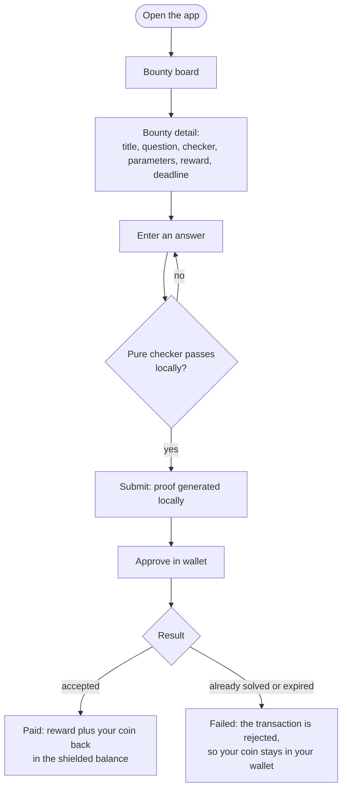

### Screens

The app (`app/`) has the board (both kinds, all four templates), setup, choosing the kind, posting
with every template, the bounty page for solver and poster, the reviewed-work page for every role
(apply with an application code, claim, submit, review, collect, refund, overturn, reopen), My
bounties, an issuer page that signs records into files, key backup and restore, read-only browsing with no wallet (on networks with a public indexer), a personal activity feed (Q14, with new applications and messages decrypted in the browser), and chat for reviewed work over Nostr relays (Q15).
Still to build: profiles beyond what an application carries ([app/README.md](app/README.md)).

| Screen | Data source | Midnight piece |
|---|---|---|
| Bounty board | Indexer subscription on the template contracts; the activity feed from `contract(address) { actions }` (Q14) | `indexerPublicDataProvider`, contract state stream, the indexer's action history |
| Post a bounty | Form, then a `postBounty` transaction | DApp Connector, proof server |
| "What goes public" review | Static, per template | Selective disclosure, made visible |
| Bounty detail | Ledger state: the bounty record and its listing (title and question) | Public params, deadline countdown from block time |
| Solve | Pure checker, then one `submit`, with progress shown: proving alone takes about 11 s on an idle machine, and the whole call took 2.5 minutes in the Q6 browser run on a loaded laptop, wallet approval included | Local proving, witnesses, shielded coins |
| My bounties / inbox | Ledger state and private state | Private state store, pure-circuit decryption |
| Refund | `refund` transaction | Block time |
| Post: choose the kind | Static | Reviewed work or verified answer (section 5) |
| Reviewed work: apply, submit, collect | Public state, the encrypted thread, then `claim`, `submit`, `collect` (planned) | Block-time windows, encryption to the poster, unlinkable collect |
| Review | The decrypted submission, then `approve` or `reject` (planned) | Review clock, optional arbiter |
| Profile | Browser only; shared per application | Selective disclosure of a name and linked accounts |

## 12. Transaction sequences

### Post a bounty

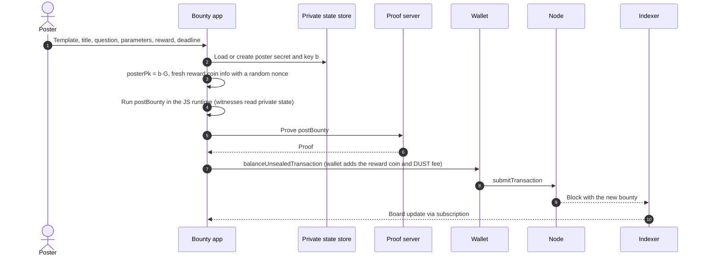

### Solve and get paid

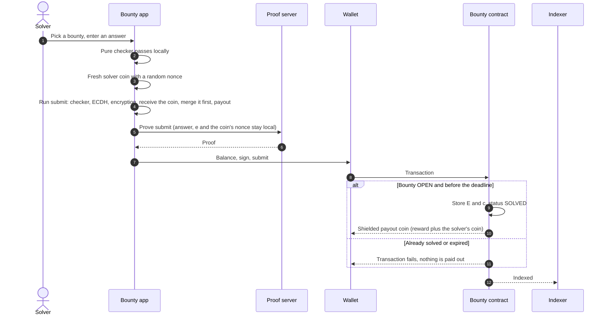

### Read the answer

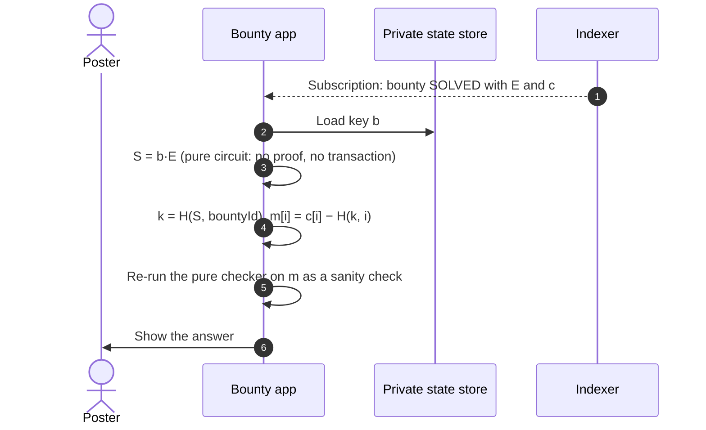

### Refund after the deadline

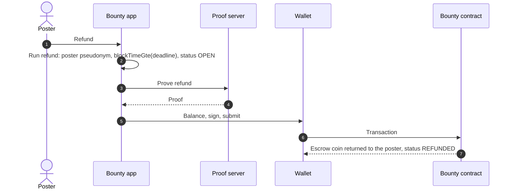

### Private offer (v2)

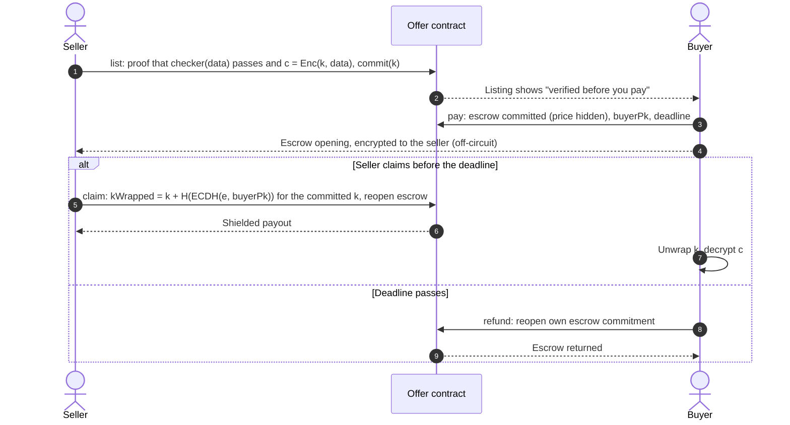

If the buyer sends a wrong opening, the seller can't claim, so they never reveal `kWrapped`, and
the buyer simply gets a refund. Neither side can cheat the other.

## 13. Midnight features: where each one does its job

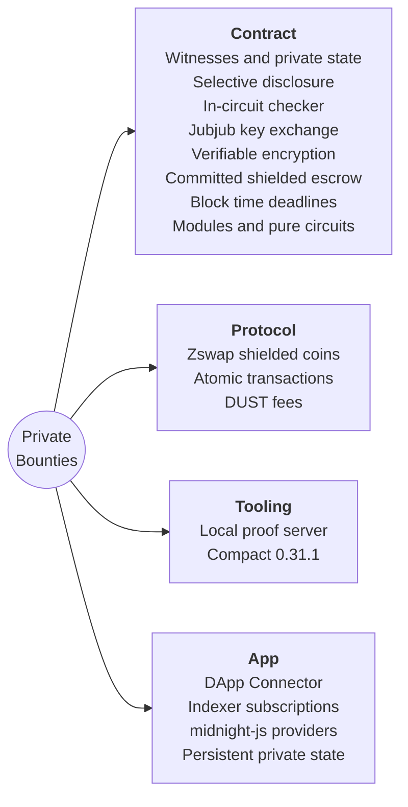

| Feature | Its job here | In midnight-examples today (`cb250c9`) |
|---|---|---|
| Witnesses and private state | Answer, `e`, the solver's coin nonce and key `b` never leave the device | Every example |
| Selective disclosure (`disclose`) | Only `E`, `c`, status and commitments go public | Every example |
| Commitments and hashing (`persistentHash`, `transientHash`) | Pseudonyms, checker, keystream | Many |
| ZK check of off-chain data | The checker runs inside the proof, before payout | zk-loan, calculator |
| Jubjub ops in-circuit (`ecMulGenerator`, `ecMul`) | Key exchange to the poster | **New use.** Only zk-loan, to verify Schnorr signatures |
| Verifiable encryption | Proves `c` encrypts the checked answer | **New** |
| Shielded escrow (`receiveShielded`, `insertCoin`, `mergeCoin`, `sendShielded`) | Reward escrow and unlinkable payout, in one transaction for the solver | shielded-chips (committed player escrow), private-tip-jar, token-transfers. **New here:** a third party claims, and in v2 the price is hidden |
| Block time (`blockTimeLt`, `blockTimeGte`) | Submit window and refund, in Unix seconds (verified) | **New.** No example uses it |
| Modules (`import ... prefix`) | Shared building blocks | zk-loan only |
| Pure circuits in JS | Browser pre-check and decryption with the exact circuit math | zk-loan (`schnorrChallenge`) |
| Shielded token minting (`mintShieldedToken`) | Test reward token | private-tip-jar, shielded-chips, token-transfers |
| Domain-separated pseudonyms | Unlinkable posters and solvers | shielded-chips and others |
| Atomic transactions | Delivery and payout land together or not at all | Implicit everywhere, central here |
| Local proof server | Private inputs proven on the user's machine | Every example |
| DApp Connector | Balancing, signing, submitting, endpoints | Example UIs |
| Indexer subscriptions | Live bounty board | Example UIs |

### What happens inside one `submit`

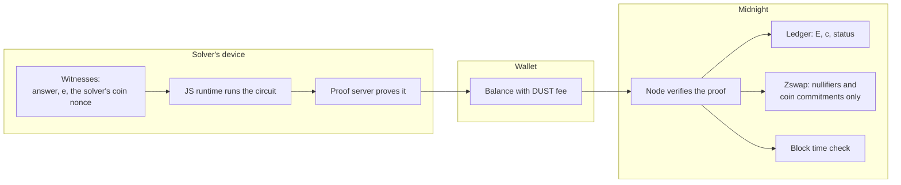

## 14. Privacy model

| Data | Who can see it |
|---|---|
| The answer | Solver; poster after decryption. On-chain only as ciphertext |
| Title and question, reward, post time | Public, and permanent: written once at post time, never changed or removed. The post time is rounded to 5 minutes |
| Bounty ID | Public, but derived from a secret salt, so it can't be linked to the poster or to their other bounties |
| Checker parameters, deadline | Public |
| Reward amount (open bounty) | Public, by design |
| Escrow coin (open bounty) | Public: nonce, value and tree position. A fresh coin, so it doesn't point at the poster's wallet |
| Which action a pseudonym took | Public: the indexer shows each transaction's circuit name (`postBounty`, `submit`, `refund`) |
| Price (private offer, v2) | Buyer and seller only 🔬 Q2 |
| Poster identity | A pseudonym per bounty (it hashes in the bounty ID), and a separate encryption key per bounty. The wallet isn't linked, and a poster's bounties can't be grouped. An earlier version used one pseudonym per deployment; the audit caught it |
| Solver identity | Nothing on chain identifies the solver at all |
| Payout destination | Shielded coin, unlinkable because the solver's coin is merged first (section 9). Verified on a local devnet for both versions |
| Refund destination | Linkable only by someone who already suspects the poster's wallet (v1 limit) |
| Poster key `b`, solver scalar `e` | Private state, and `e` is discarded after proving |
| Fees | Paid in DUST |
| Reviewed work: who is assigned | A per-bounty pseudonym. Their profile only if they share it: with the poster by default, or with everyone once assigned |
| Reviewed work: the submission and messages | Ciphertext to the poster; messages between the two parties' keys, carried by Nostr relays. Relays see the connecting IP, timing and ciphertext. Each bounty's inbox tag can be computed from the public bounty, so someone reading the chain and the relays can count a bounty's applications (not who sent them, or what they say). A thread's tag can only be computed by its two parties |
| Reviewed work: actions | Public, like every circuit name: assigned, submitted, approved, rejected, paid |
| Metadata | Timing and transaction graph. Not hidden by the app |

## 15. Threat model

| Threat | Mitigation |
|---|---|
| Solver submits a wrong answer | The checker runs in the circuit, so no valid proof means no payout |
| Solver encrypts garbage or uses the wrong key | The proof binds `c` to `posterPk` through ECDH and the keystream |
| Poster refuses to pay | Can't block a valid payout: payout and delivery are one transaction |
| Poster claims their own bounty | A poster who knows an answer (always for `preimage`, and for `factor` when they generated N) can submit it themselves and take the reward back before the deadline. A solver loses effort but no funds. This can't be prevented in-circuit, so it is a stated trust assumption for those templates |
| Poster refunds early | `refund` requires `blockTimeGte(deadline)` |
| Solver submits late | `submit` requires `blockTimeLt(deadline)` |
| Two solvers race | The first to land wins. Both spend the same escrow coin, so the node rejects the other transaction whole and the losing solver's coin never leaves their wallet (verified, Q5) |
| Copying a pending submission | Nothing to copy: the answer is encrypted and the payout is bound in the proof |
| Payout traced to the solver's wallet | Solver's fresh coin merged first (section 9) |
| Escrow traced to the poster's wallet | The app always builds the escrow as a fresh coin with a random nonce, never a wallet coin's nonce |
| Concurrent calls from one user | Calls run one at a time, with one private-state store per user (two at once collided on the store's lock in Q2) |
| Small answer space | The checker itself can leak the answer (a 4-digit PIN can be brute-forced). In `preimage` the target is the answer's public hash, so a short answer can be found by hashing guesses, and the same answer posted twice shows the same target (seen in Q6). The UI warns about short and reused answers, and templates avoid it |
| Field wraparound in a checker | Checkers use bounded `Uint` arithmetic (`p × q = N` with no modular wrap) |
| Invalid or low-order `posterPk` or `issuerPk` | `postBounty` rejects them: the proof checks the key is on the curve and in the prime-order subgroup, and an assert rejects the identity point, which would make every shared key public |
| Biased issuer signatures | `signing.ts` draws Schnorr nonces uniformly modulo the subgroup order. An earlier version drew them from 248 bits, which leaks enough to recover an issuer's key from roughly a hundred signatures |
| A signature made for another app | Signed-record bounties pin a schema tag in `record[0]`, so a zk-loan attestation from the same issuer doesn't qualify |
| A submit that lands after the deadline | Rejected whole, with the solver's coin left in their wallet (devnet test D5). The UI warns near the deadline, because a submit takes minutes to prove, approve and land (2.5 minutes in the Q6 browser run) |
| A wallet or hosted prover sees the proof's inputs | The app proves locally by default. Choosing wallet proving shows a warning first, because the wallet, or the hosted service it may use, sees the secret inputs: the poster's identity secret, or the solver's answer and coin (Q10) |
| The title or question identifies the poster | The text is public and permanent, and the same writing style or details across bounties can link them, which the per-bounty pseudonym otherwise prevents. The post screen's review step shows the text under "what goes public" |
| Bounty ID squatting | Fixed in the second audit (L3). `postBounty` derives the ID in the circuit from a secret salt and the poster's identity secret, so someone who copies a pending post gets a different ID and the poster's post still lands |
| Board spam | Listings are permanent and up to the ledger's 32 KiB cell each. A deploy-time minimum reward and minimum open window make each post lock capital, not only fees (second audit, L1) |
| A misleading listing | The text is the poster's word, not checked. The app shows the on-chain parameters as the authoritative ones, and a wrong answer is rejected before anything is proved, so a solver loses effort, not funds (second audit, S1, planned) |
| Poster loses key `b` | Key backup in the app: one file with every board contract's private state, exported by midnight-js and encrypted under the passphrase. A new browser restores it before or after joining |
| `transientHash` changes at a hard fork | The poster's app decrypts as soon as a bounty is solved, keeps the plaintext, and pins its runtime version |
| A buyer re-shares purchased data (v2) | Inherent to selling data. Out of scope |
| Reviewed work: the poster never reviews | The review clock: once it runs out, the contributor collects without an approval |
| Reviewed work: the poster rejects good work | The optional arbiter can overturn it. Without one, the contributor trusts the poster, as on today's bounty programs, but can't be ghosted |
| Reviewed work: a contributor claims and never delivers | The assignment ends with the delivery window, and anyone can `reopen` the bounty |
| Reviewed work: someone keeps re-claiming to block a bounty | Applicant mode, the default, isn't affected. In first-to-claim mode the poster can `release` an assignment that hasn't submitted (section 5, "Squatting") |
| Reviewed work: a contributor submits and never collects | The collect-by limit: once it passes, the poster can take the reward back (section 5) |
| Reviewed work: someone copies a submission | Submissions are encrypted to the poster, so there's nothing public to copy |
| Reviewed work: the arbiter sides with the poster unfairly | A stated trust assumption: the arbiter is named at post time, so contributors can choose not to apply |

## 16. Checker templates (v1)

| Template | The bounty asks for | Public parameters | Private answer | Why it's in v1 |
|---|---|---|---|---|
| `preimage` | x with `transientHash(x) = target` | target | x | Smallest circuit, used by the spike |
| `factor` | p, q > 1 with `p × q = N` | N (4 to 2^128 − 1, range-checked at post time), in the same `target` slot | p (smaller, 64-bit) and q (128-bit) | The classic ZKCP demo. Built: the product stays below 2^192, so fake factors that only multiply to N modulo the field fail, and every factorisation of a valid N can be submitted |
| `signed-record` | An issuer-signed record of a given type whose field f ≥ X | issuer key, schema tag, f (1 to 3), X | Record and signature | Real data-marketplace use. Built: zk-loan's Schnorr module verifies the signature in-circuit, `record[0]` must equal the bounty's schema tag so signatures made for other purposes don't qualify, and f is compared as a 64-bit integer. Binding a record to a subject is the issuer's job |

Rule from Q1: checkers use `transientHash` wherever they can. A SHA-256 (`persistentHash`)
checker made the core circuit 8x bigger (k = 14 instead of 11) and about 3x slower to prove.

## 17. Target stack

| Component | Version |
|---|---|
| Compact compiler | 0.31.1 (`compact compile +0.31.1 ...`) |
| `@midnight-ntwrk/compact-runtime` | 0.16.0 (what 0.31.1 output checks for) |
| midnight-js | 4.1.1 |
| DApp Connector API | 4.0.1 |
| `ledger-v8` | 8.1.x |
| `wallet-sdk-facade` | 4.1.0, pinned (the npm `latest` tag still points to 4.0.1) |
| Node / indexer / proof server | 1.0.400 / indexer-standalone 4.3.3 / 8.1.0 |
| Networks | Local, then Preview, then Preprod (the spike devnet ran node 1.0.0, as in the examples' compose) |
| Block time | Seconds since the Unix epoch (`blockTimeLt`/`Gte` take a `Uint<64>`) |

## 18. Open questions and spike results

| # | Question | Status | Result |
|---|---|---|---|
| Q1 | Is `submit` provable in reasonable time and size? | ✅ Answered | Crypto core k = 11, proves in 0.4 s on an idle runner; SHA-256 checker k = 14. [Results](spike/q1-proof-size/RESULTS.md) |
| Q2 | What exactly is public after `postBounty`, `submit`, `refund`? | ✅ Answered | Escrow coin public as designed; solver's coin, payout nonce and wallet keys never public; action names public. [Results](spike/q2-escrow/RESULTS.md) |
| Q3 | Can a coin received in the same transaction be the **first** merge input? | ✅ Works | One-transaction `submit` paid out on a local devnet, no effects-budget error. [Results](spike/q2-escrow/RESULTS.md) |
| Q3b | Does the one-transaction payout pass the same leak check as Q2? | ✅ Answered | Yes: solver's coin, payout nonce, wallet keys and secret never public. [Results](spike/q2-escrow/RESULTS.md) |
| Q4 | Do pure circuits off-chain reproduce the circuit's `ecMul` and `transientHash`? | ✅ Answered | Poster decrypts exactly; a wrong key doesn't (JS runtime). [Results](spike/q1-proof-size/RESULTS.md) |
| Q5 | Does a failing `submit` leave no partial state? | ✅ Answered | Bad calls are rejected before proving. Racing submits: one wins, the other is rejected whole and the loser keeps their coin. [Results](spike/q2-escrow/RESULTS.md) |
| Q6 | Can the wallet (Lace, 1AM) balance a transaction that pays in and receives a payout? | ✅ Yes with 1AM | On Preview, 1AM funded the reward escrow from the poster's shielded tokens, and a solver holding none of the token submitted with a zero-value coin and received the reward. Refund and in-browser decryption worked too. Two first attempts failed inside the wallet and passed on retry, so the UI offers a retry. Lace not run yet. [Results](spike/q6-wallet/RESULTS.md) |
| Q7 | Block time units and drift | ✅ Answered | Unix seconds; deadline checks enforced on chain. [Results](spike/q2-escrow/RESULTS.md) |
| Q8 | Persistent, encrypted browser private state | ✅ Answered | The UI template's store (midnight-js's LevelDB provider on IndexedDB, passphrase-encrypted, per wallet account) kept the poster's identity secret and key seed across re-joins on Preview: refund and decrypt both worked afterwards. midnight-examples checked the reload round trip and wrong-passphrase refusal for the same store. [Results](spike/q6-wallet/RESULTS.md) |
| Q9 | `JubjubPoint` and vectors inside ledger map values | ✅ Answered | Stored in `Bounty` and `Delivery` structs, read back and decrypted in the runtime. [Results](spike/q11-full-submit/RESULTS.md) |
| Q10 | Which prover may a user's wallet use? | ✅ Decided | Every circuit has secret inputs, so the app proves on a local proof server by default. Wallet proving is an opt-in, with a warning that the wallet, and any hosted prover it uses, sees the proof's inputs (on the solve screen, the answer). It isn't blocked, so users without a local proof server aren't shut out |
| Q11 | Cost of the full `submit` (checker, key exchange, encryption, escrow) | ✅ Answered | k = 16, about 11 s to prove on an idle runner; the escrow sets the size. [Results](spike/q11-full-submit/RESULTS.md) |
| Q12 | Can a solver's coin be zero-value? | ✅ Answered | Yes: a solver holding none of the reward token submitted with a zero-value coin, was paid in full, and the payout passed the Q2 leak checks. Solvers don't need the token, and the contracts accept a zero-value solver coin (the reward must still be non-zero). [Results](spike/q2-escrow/RESULTS.md) |
| Q13 | Reviewed work: can the contract enforce an exclusive claim window and a review clock with block-time comparisons only, keep the collect unlinkable, and let an arbiter overturn a rejection? | ✅ Works on a devnet | The contract passed 18 simulator tests: two-sided window checks, silence pays, collect merges a fresh coin first, arbiter overturn, refund. It found two gaps: squatting and rewards locked if nobody collects. Both are fixed in the template, `bounty_reviewed_work` (`release` and the collect-by limit), which passes 25 simulator tests and 5 devnet tests (2026-11-02): applicant mode end to end with the Q2 leak checks, silence pays on real block time, first to claim with `release`, and the collect-by refund. A wallet run is still to do. [Results](spike/q13-reviewed-work/RESULTS.md), devnet test `src/test/bounty_reviewed_work.test.ts` |
| Q14 | Can the UI read a contract's history (activity, post times, paid amounts) from the indexer? | ✅ Answered | Yes: `contract(address) { actions(limit) }` on the Preview indexer lists every action with its circuit name, block timestamp (in milliseconds) and the state after it. It doesn't say which bounty changed (compare states), and it doesn't page by offset. Post time and amount are simpler written into `listings` at post time, which they now are (section 7). [Results](spike/q14-indexer-history/RESULTS.md) |
| Q15 | Can bounty chat run over public Nostr relays? | ✅ Answered | Yes: five of seven relays took our events, delivered them live in 150 to 480 ms, returned them by thread tag, and kept only the newer version of an edit. Every one took 4 KiB; some refused 16 or 64 KiB, one banned the IP. `nostr-tools` adds 16.6 KB gzipped. After 19 hours four of the five relays still had the events and one had dropped them, so the app also keeps them in the browser; a week still to check. [Results](spike/q15-nostr-chat/RESULTS.md) |

## 19. Build plan (tentative)

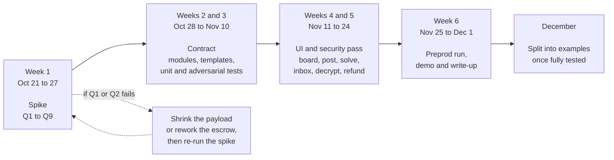

| Phase | Dates | Exit criteria |
|---|---|---|
| Spike | Oct 21 to 27 | Q1 to Q9 answered with numbers, or a design change agreed |
| Contract | Oct 28 to Nov 10 | Three templates, simulator tests plus adversarial cases passing |
| UI and security | Nov 11 to 24 | Full flow working on the local network, security pass done |
| Reviewed work | Nov 2 to 14 | Q13 answered, then a fourth template with simulator and devnet tests |
| Preprod and demo | Nov 25 to Dec 1 | End-to-end run on Preprod, demo recorded, write-up drafted |
| Examples | December | Modules split out with their own tests and docs |

## 20. Splitting into examples

Only after the full app is built and thoroughly tested:

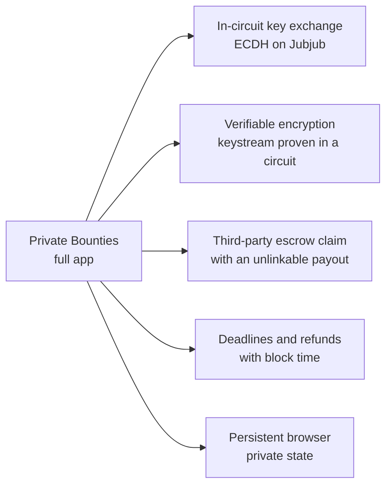

## 21. References

- Atomic and Fair Data Exchange via Blockchain, ACM CCS 2024: https://dl.acm.org/doi/10.1145/3658644.3690248
- cont-pay, a ZKCP prototype (CCS 2020): https://github.com/security-kouza/cont-pay
- Algebraic Zero-Knowledge Contingent Payment: https://eprint.iacr.org/2024/1930.pdf
- SmartZKCP, practical attacks on ZKCP marketplaces: https://www.sciencedirect.com/science/article/pii/S209672092400085X
- Compact standard library at `compactc-v0.31.1`: https://github.com/LFDT-Minokawa/compact/blob/compactc-v0.31.1/compiler/standard-library.compact
- midnight-examples `shielded-chips/contract/roulette.compact`: committed escrow and payout-nonce privacy
- midnight-examples `zk-loan/contract/schnorr.compact`: Jubjub ops, scalar reduction, modules, pure circuits
- Midnight docs: https://docs.midnight.network
